# speakrs-v100

Native CUDA speaker diarization on the **NVIDIA Tesla V100** (compute capability 7.0, `sm_70`).

This repository holds forks of [speakrs](https://github.com/avencera/speakrs) and its CUDA host crate [cudakit](https://github.com/avencera/cudakit). Upstream speakrs supports Turing (`sm_75`) and newer GPUs and refuses a V100 at startup. These forks add an `sm70` kernel tier and rewrite the FP16 embedding-trunk kernels for Volta tensor cores. In a `cuda-v100` build, the whole pipeline runs on the V100 without cuDNN or cuBLAS.

**Baseline** below is the upstream FP32 trunk kernels built for `sm_70` (milestone M1). **Ours** is the Volta FP16 trunk added here (milestone M2). Everything else in the pipeline is the same.

| Metric | Baseline (FP32 kernels) | **Ours** (Volta FP16 tiles) |
|---|---:|---:|
| VoxConverse dev DER, `cuda` mode | 7.0125% | **7.0118%** |
| VoxConverse dev DER, `cuda-fast` mode | 7.3676% | **7.3676%** |
| End-to-end speed, `cuda` (A/B median) | 1.00x (16.8 s) | **3.00x** (5.6 s) |
| End-to-end speed, `cuda-fast` (A/B median) | 1.00x (9.9 s) | **3.09x** (3.2 s) |
| Real-time factor, `cuda` / `cuda-fast` | 249x / 422x | **746x / 1305x** |
| 3x3 trunk layers, batch 32 | 1.00x | **2.83x** |
| GPU kernel time, one 607 s file | 2.75 s | **0.94 s** |

All measurements come from one Tesla V100-SXM2-16GB with a 4-core AMD Ryzen 3 3200G host, driver 580.178.04, on an otherwise idle GPU (November 2026). The A/B rows alternate the two builds for five rounds on the four longest dev files (69.6 minutes of audio). Each build processes all files in one process, as the speakrs benchmark harness does.

## Overview

<table>
<tr><td colspan="2">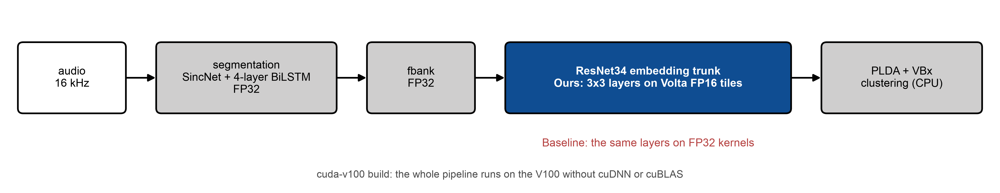<br><sub>Where Ours runs: the 3x3 layers of the embedding trunk. Baseline runs the same layers on FP32 kernels.</sub></td></tr>
<tr><td colspan="2">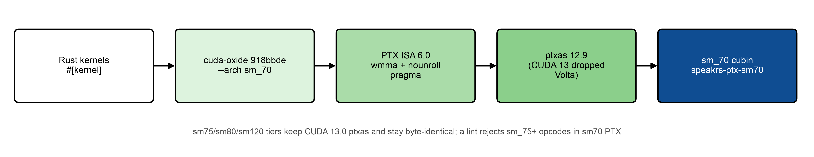<br><sub>How the sm70 variant is built. CUDA 13 dropped Volta, so sm_70 cubins come from a pinned CUDA 12.9 ptxas.</sub></td></tr>
</table>

## Results

<table>
<tr>
<td width="50%">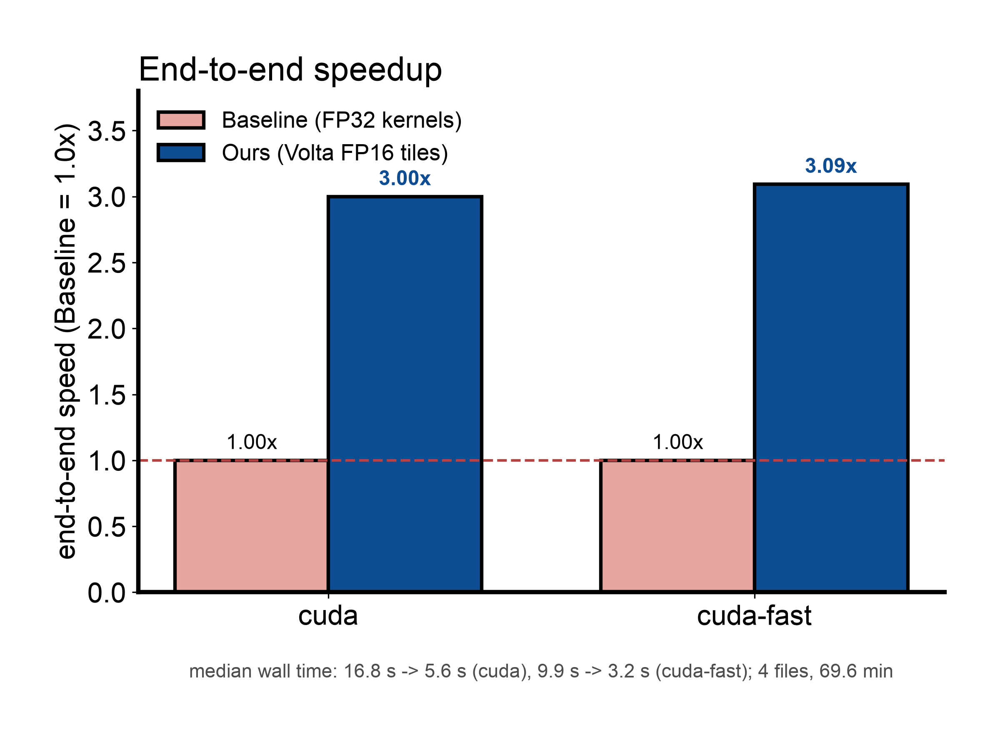</td>
<td width="50%">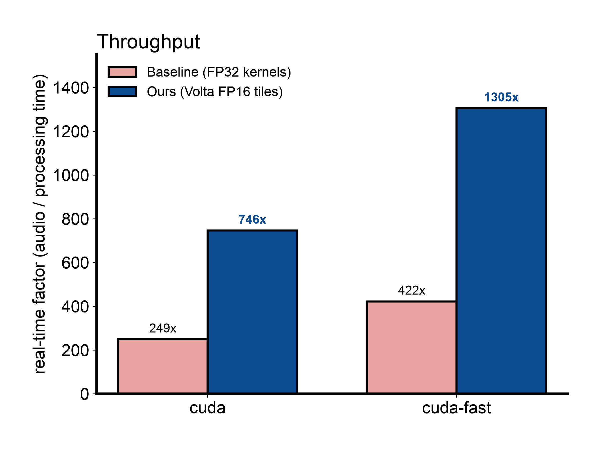</td>
</tr>
<tr>
<td><sub><b>End-to-end speedup.</b> Speed relative to Baseline (1.0x), from A/B medians on the same files.</sub></td>
<td><sub><b>Throughput.</b> Real-time factor (audio length / processing time) of the same runs. On all 216 dev files the benchmark harness measures Ours at 752x (<code>cuda</code>) and 1293x (<code>cuda-fast</code>).</sub></td>
</tr>
<tr>
<td>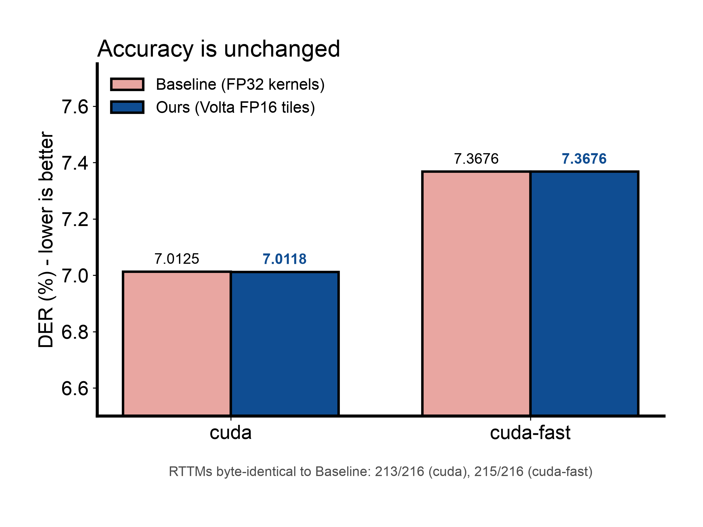</td>
<td>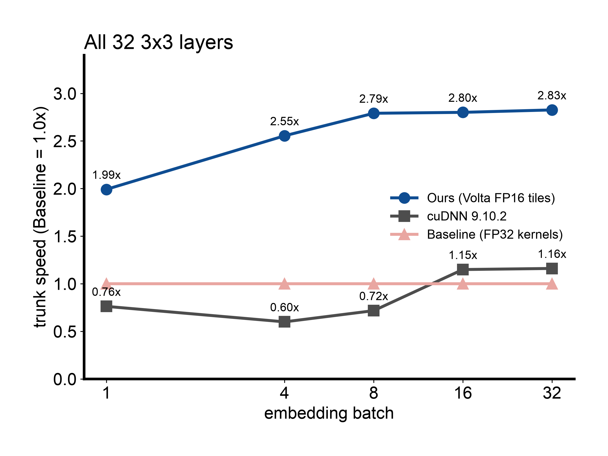</td>
</tr>
<tr>
<td><sub><b>Accuracy.</b> DER on all 216 VoxConverse dev files is unchanged within 0.001 points. The two files whose DER moved match the T4 FP16 result upstream reports.</sub></td>
<td><sub><b>Trunk speed against batch.</b> All 32 3x3 layers, CUDA-graph medians. Ours is 1.99x Baseline at batch 1 and 2.83x at batch 32. cuDNN is slower than Baseline below batch 16.</sub></td>
</tr>
<tr><td colspan="2">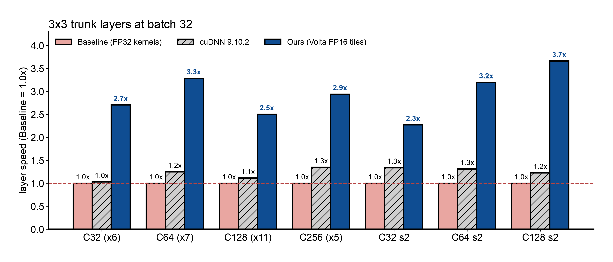<br><sub><b>Per layer class at batch 32.</b> Ours is 2.3-3.7x Baseline on every class and faster than cuDNN everywhere. Per-layer errors against an f64 reference stay within the TF32 bound in all 410 checks (relative L2 error 1.2e-4 to 4.7e-4).</sub></td></tr>
<tr>
<td>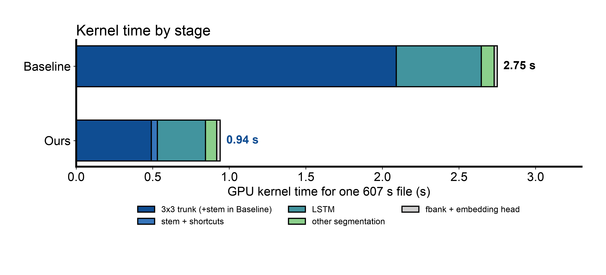</td>
<td>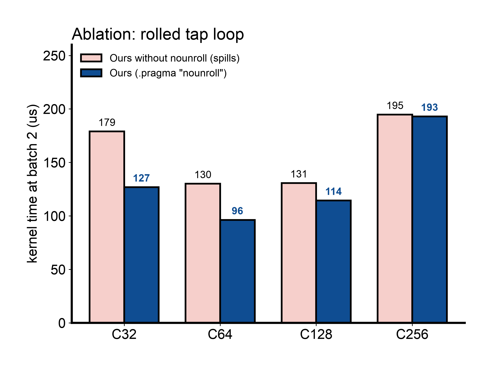</td>
</tr>
<tr>
<td><sub><b>GPU kernel time by stage</b> for one 607 s file. Across all dev files the GPU is busy 98% of the wall time, so the 4-core CPU is not the bottleneck.</sub></td>
<td><sub><b>Ablation inside Ours.</b> Without the <code>nounroll</code> pragma, ptxas unrolls the tap loop, the registers spill, and the kernels run up to 1.41x slower (batch 2, Nsight Compute).</sub></td>
</tr>
</table>

Single full-dev runs vary by about 15% from run to run, so the alternating A/B ratio is the figure to quote. A V100 tune file (`speakrs cuda tune`) adds about 1-2% by running the stem with the Spatial kernel at batch 32.

## Design

<table>
<tr>
<td width="50%">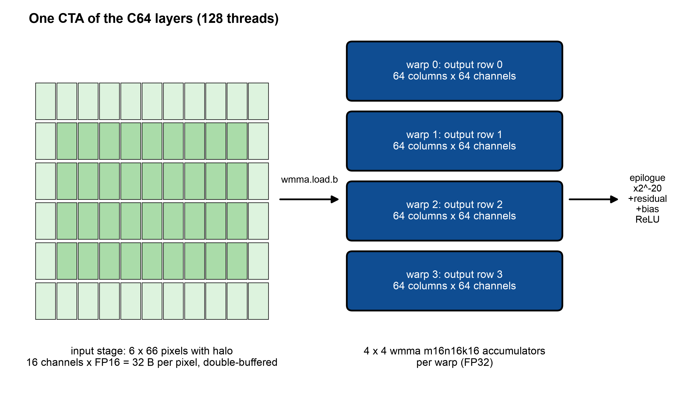</td>
<td width="50%">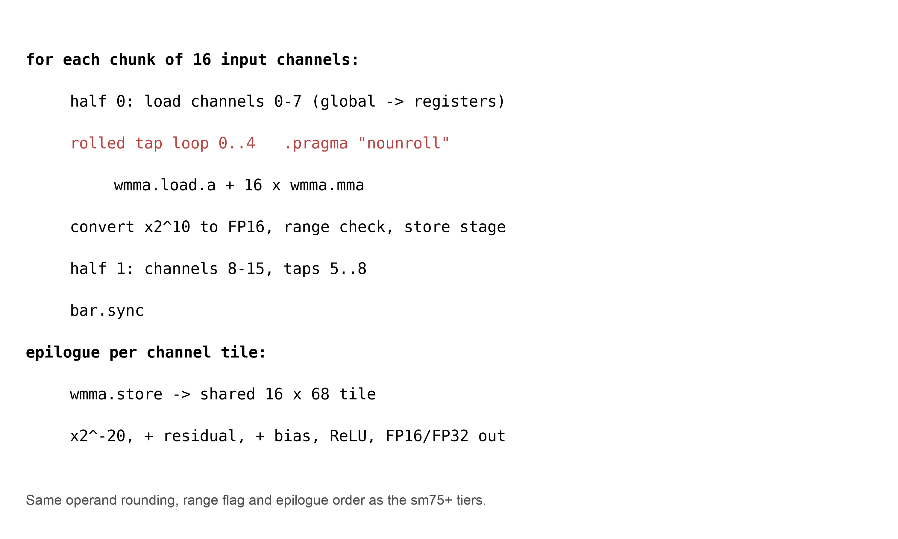</td>
</tr>
</table>

- **`sm70` tier.** cudakit gains `PtxTier::Sm70` below the `sm75` baseline. `Profile::floor()` accepts compute capability 7.0 only when a build compiles the tier in, so builds without it still refuse a V100.
  - Every kernel area ships an `sm70` variant built from the same sources.
  - The `sm75`/`sm80`/`sm120` PTX and cubins stay byte-identical.
- **Toolchain.** CUDA 13 removed offline compilation for Volta. The `sm_70` cubins therefore come from a second pinned `ptxas` (CUDA 12.9, V12.9.86), while the other tiers keep CUDA 13.0.
  - cuda-oxide (rev `918bbde`) emits PTX ISA 6.0 for `--arch sm_70`.
  - A lint rejects `sm_75+` opcodes (`ldmatrix`, `mma.m16n8k8`, `cp.async`, ...) in `sm70` PTX.
- **Volta FP16 tiles.** Volta has neither `ldmatrix` nor the `m16n8k8` MMA shape of the upstream FP16 tiles. The `sm70` variant computes the same tiles with `wmma` m16n16k16 products over 16-channel chunks.
  - Each chunk is staged at 32 bytes per pixel, which is the column-major B operand `wmma.load.b` reads, and double-buffered.
  - Each warp keeps a 64-column output row in FP32 accumulators.
  - Operand rounding (x2^10, round to nearest, saturation), the range flag that triggers an FP32 recompute, and the epilogue order (x2^-20, residual, bias, ReLU) are those of the other tiers.
  - Stride-1, stride-2 and half-precision I/O variants are covered: 42 entries.
- **Rolled tap loop.** On Volta, one `wmma` m16n16k16 product compiles to 16 `HMMA.884` instructions.
  - With all nine taps unrolled, a chunk iteration overflowed the instruction cache and the registers spilled.
  - cuda-oxide keeps loops rolled, but `ptxas` unrolled them again because their trip counts are constant. Hiding the bound behind a `mov` does not stop it.
  - A statement-level `.pragma "nounroll";` at the loop header keeps the loop rolled. The loop index passes through the same inline-asm statement, so the pragma stays the header's first statement.
  - Result: no spills in any of the 42 entries, and the C32/C64 kernels run 1.35-1.41x faster.
- **Routing.** Like Turing, Volta has no TF32 hardware. TF32 mode, the embedding default, therefore runs every 3x3 trunk layer except the stem on the FP16 tiles (`DeviceDefault::VoltaFp16Trunk`).
  - Narrow tiles are used when wide ones would give fewer than two CTAs per SM on the 80-SM V100.
  - FP32 mode keeps the FP32 kernels.

## Repository layout

| Path | Contents | Base |
|---|---|---|
| `speakrs/` | `cuda-v100` (`cuda-sm70`) feature, `sm70` kernel variants, Volta FP16 trunk, V100 routing, CI and packaging | avencera/speakrs `669e810` |
| `cudakit/` | `PtxTier::Sm70`, dual `ptxas` pins, `sm70` manifest lines and lint | avencera/cudakit (`v100-sm70` branch) |
| `spikes/volta-tc/` | Volta `wmma` / `mma.m8n8k4` correctness spikes | |
| `tools/voxconverse_hf/` | Fetches VoxConverse dev from a Hugging Face mirror | |
| `docs/figures/` | The figures above (one chart per image) and `make_figures.py`, which draws them in the [figures4papers](https://github.com/ChenLiu-1996/figures4papers) style | |
| `V100_STATUS.md`, `PLAN-v100.md` | Status notes and the original plan (Korean) | |

`speakrs/Cargo.toml` patches `cudakit` and `cudakit-build` to the sibling `../cudakit` directory, so the two folders must stay side by side.

## Build and run

```bash
cd speakrs
cargo build --release -p xtask --features cuda,cuda-v100
target/release/xtask diarize --mode cuda --models-dir <models> input.wav > out.rttm
```

- **`cuda-v100` alone** is driver-only: it needs neither the CUDA toolkit nor cuDNN, because the PTX and cubins are committed.
- **Adding `cuda`** also enables the cuDNN/cuBLAS fallback. cuDNN 9.10 is the last release that supports Volta, and the R580 driver branch is the last that supports the V100.
- **Rebuilding kernels** needs the toolchain in `speakrs/docker/v100-dev.Dockerfile`: CUDA 12.9 `ptxas` in `CUDA12_HOME` next to CUDA 13. Run it with `cargo xtask cuda-kernels build <area>` and check with `cargo xtask cuda-kernels check`.
- **Tune file (optional).** `speakrs cuda tune --models-dir <models>` writes a device-specific tune file. On the V100 it adds about 1-2% by running the stem with the Spatial kernel at batch 32.

## Tests run on the V100

- 370 library tests and 4 `cuda_pipeline` tests pass on the V100, and 370 host tests pass on macOS.
- A half-I/O parity test checks the FP16 tiles: half and FP32 inputs give bit-identical results, and saturating outputs set the range flag.
- 410 per-layer checks compare the FP16 tiles against cuDNN and an f64 truth.
- A deliberately wrong epilogue scale fails those checks, as a negative control.
- `cargo xtask cuda-kernels check` passes. The packaged `speakrs-ptx-sm70` crate is 2.46 MB.

## Remaining work

- **Trunk kernel efficiency.** At batch 32 the production FP16 kernels keep the tensor pipe 53-60% busy. Two limits are measured:
  - Occupancy is 12.5% (226-227 registers per thread, 8 warps per SM).
  - The largest stall is fixed-latency dependency (`wait`).
  - The SASS issues the four dependent k-step groups of each `wmma` product back to back, which is the likely cause; this is not yet verified.
  - Candidates: `mma.sync.m8n8k4` (PTX 6.4) with k-steps interleaved across output tiles, staging all 16 channels at once to remove the 9-13% shared-store bank conflicts, and prefetching the next tap's weight fragments.
  - Estimated gain: 10-25% end to end.
- **LSTM recurrence.** The plan selection is already optimal at the production batch sizes (1 and 32), and these kernels are 1.8-3.8x faster than cuDNN's LSTM.
  - Going further needs a V100-specific kernel. Options are splitting the recurrent matrix across two blocks per window, or storing it in FP16, which needs a DER check.
  - Estimated gain: 3-7%.
- **Smaller items:**
  - Make the batch-32 Spatial stem a Volta rule instead of a tune-file choice.
  - Measure VRAM per embedding batch class.
- **Upstreaming.** It is still open whether to propose the `sm70` tier to upstream speakrs and cudakit, and whether to add `cuda-sm70` to the default `cuda` feature.

## License

`speakrs/` and `cudakit/` keep their upstream Apache-2.0 licenses.
